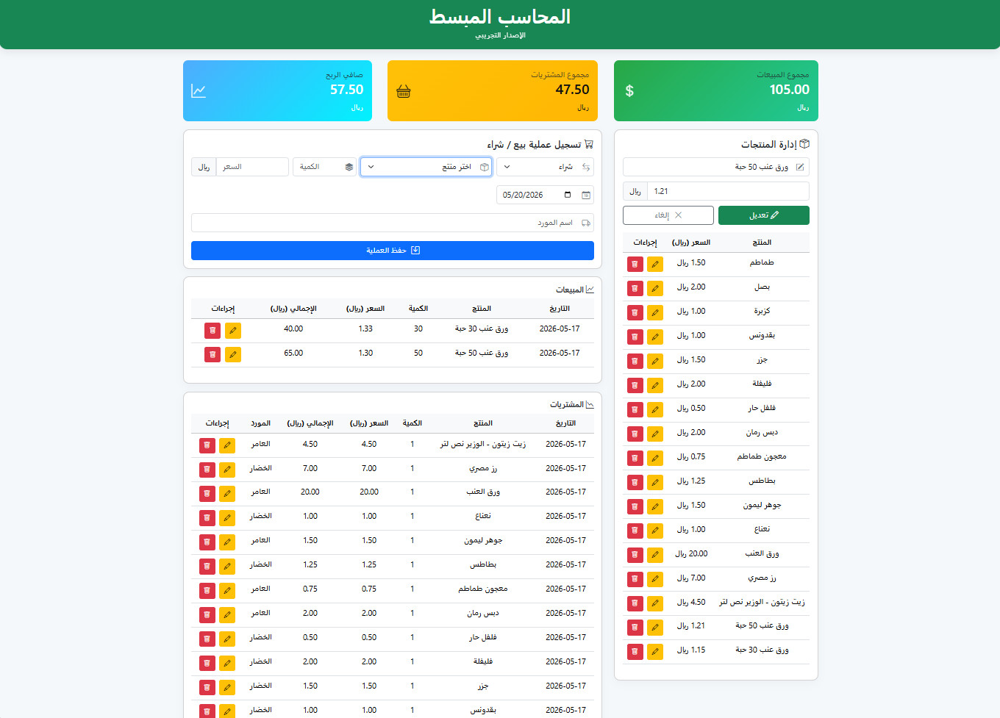
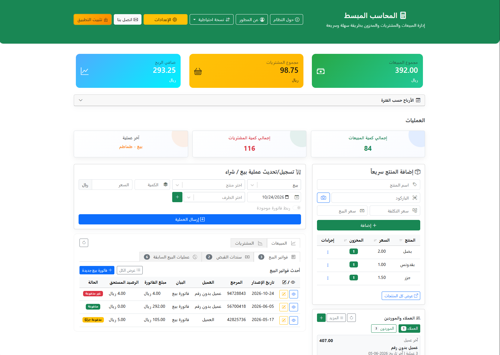
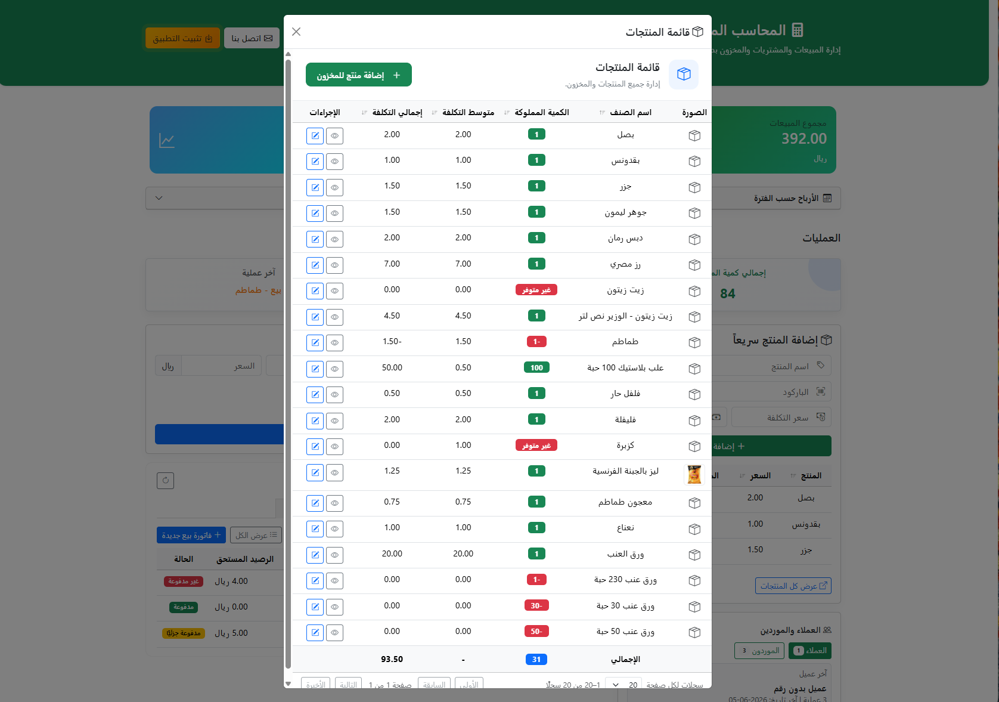

---

# 💼 المحاسب المبسط | Simple Accountant

نظام محاسبة مبسط وسهل الاستخدام يساعد أصحاب المشاريع الصغيرة على إدارة المبيعات والمشتريات والمنتجات بطريقة منظمة وسريعة — يعمل كتطبيق PWA قابل للتثبيت على الهاتف والحاسوب، مع دعم العمل بدون إنترنت.

A simple and lightweight accounting system designed to help small businesses manage sales, purchases, and products easily — now a **Progressive Web App (PWA)** that can be installed on phones and desktops and works offline.

---

# 🚀 المميزات | Features

## 🇸🇦 المميزات العربية

* ➕ إضافة المنتجات بسهولة
* 🧾 تسجيل عمليات البيع والشراء (فواتير المبيعات والمشتريات)
* 📊 حساب الأرباح بشكل تلقائي + تقارير حسب الفترة
* 💾 تخزين البيانات داخل المتصفح (IndexedDB) — لا خادم ولا قاعدة بيانات خارجية
* 📲 **تثبيت التطبيق على الشاشة الرئيسية** (iOS / Android / حاسوب)
* 📶 **العمل بدون إنترنت** بعد التثبيت، مع بقاء البيانات في جهازك
* 🔄 **تحديث تلقائي للنسخة** عند نشر إصدار جديد (دون أكواخ قديمة)
* ✏️ تعديل وحذف العمليات بسهولة
* 🏷️ دعم إدخال المنتجات بالباركود / الكاميرا
* 📦 واجهة بسيطة وسهلة الاستخدام

## 🇬🇧 English Features

* ➕ Add products easily
* 🧾 Record sales and purchases (sales / purchase invoices)
* 📊 Automatic profit calculation + period reports
* 💾 Store data locally using IndexedDB — no external database
* 📲 **Install the app on the home screen** (iOS / Android / Desktop)
* 📶 **Works offline** once installed, data stays on your device
* 🔄 **Automatic app updates** after deploying a new version (old caches purged)
* ✏️ Edit and delete transactions
* 🏷️ Barcode / camera product entry
* 📦 Simple and user-friendly interface

---

# 🖥️ صور المشروع | Screenshots

## 🏠 الصفحة الرئيسية | Dashboard



## 🖥️ لوحة التحكم | Accounting dashboard



## 📦 قائمة المنتجات | Products list



---

# 🚀 Live Demo | النسخة التجريبية

## 🇸🇦 Arabic

🔗 **اضغط هنا لتجربة النظام**

👉 https://accounting-app-ochre-omega.vercel.app/accounting

> على الجوال: افتح الرابط من موقع التطبيق، ثم اضغط زر **«تثبيت التطبيق»** في أعلى الصفحة واتبع الشرح — وأضف التطبيق إلى الشاشة الرئيسية.

## 🇬🇧 English

🔗 **Try the live demo**

👉 https://accounting-app-ochre-omega.vercel.app/accounting

> On mobile: open the link, tap the **Install App** button at the top and follow the steps to add it to your home screen.

---

# ⚙️ طريقة التشغيل | How to Run

## 🇸🇦 التشغيل

### وضع التطوير

```bash
npm install
npm run dev
```

### بناء نسخة الإنتاج ونشرها محليًا

```bash
npm run build
npm run start
```

> ملاحظة PWA: يعمل التثبيت والعمل بدون إنترنت عبر Service Worker الذي يتطلب **نطاقًا آمنًا (HTTPS)** — يُستثنى فقط `http://localhost`. على الشبكات الداخلية يُفضَّل استخدام شهادة SSL (حتى لو ذاتية التوقيع) أو النشر على Vercel/أي استضافة HTTPS.

## 🇬🇧 Run Instructions

### Development

```bash
npm install
npm run dev
```

### Production build & local serve

```bash
npm run build
npm run start
```

> PWA note: installation and offline support rely on a Service Worker, which requires a **secure context (HTTPS)** — only `http://localhost` is exempt. For internal networks use an SSL certificate (even self-signed) or deploy to an HTTPS host like Vercel.

---

# 🧪 الاختبارات والجودة | Tests & Quality

```bash
npm test       # اختبارات الوحدات / unit tests
npm run lint   # فحص الكود / code quality
```

---

# 🧱 التقنيات المستخدمة | Tech Stack

## 🇸🇦 عربي

- ⚛️ Next.js (إطار عمل React للإنتاج)
- 🧩 React (لبناء واجهة المستخدم التفاعلية)
- 🌐 HTML5 (هيكلة الصفحات)
- 🎨 CSS3 + Bootstrap (تصميم الواجهة والتصميم المتجاوب)
- ⚙️ JavaScript (منطق التطبيق)
- 🗄️ IndexedDB (تخزين البيانات محليًا داخل المتصفح)
- 📦 LocalStorage (تخزين بيانات خفيفة وسريعة)
- 🧩 **Web App Manifest + Service Worker** (تطبيق PWA: تثبيت، أوفلاين، تحديث تلقائي)
- 🔍 **ZXing** (قراءة الباركود بالكاميرا)
- 🚀 Vercel (استضافة المشروع)

## 🇬🇧 English

- ⚛️ Next.js (The React Framework for Production)
- 🧩 React (For building user interfaces)
- 🌐 HTML5 (Structure of web pages)
- 🎨 CSS3 + Bootstrap (Styling and responsive design)
- ⚙️ JavaScript (Core application logic)
- 🗄️ IndexedDB (Client-side database for storing structured data in the browser)
- 📦 LocalStorage (Simple key-value storage in the browser)
- 🧩 **Web App Manifest + Service Worker** (PWA: install, offline, auto-update)
- 🔍 **ZXing** (camera barcode scanning)
- 🚀 Vercel (Deployment and hosting platform)

---

# 👨‍💻 Developer | المطور

**alshagag**

---

# ⭐ Notes | ملاحظات

## 🇸🇦 عربي

* المشروع يعمل بدون قاعدة بيانات خارجية
* جميع البيانات محفوظة داخل المتصفح (LocalStorage / IndexedDB) وليست على أي سيرفر
* التثبيت والأوفلاين يتطلبان HTTPS (عدا localhost) — انظر قسم التشغيل
* مناسب للمشاريع الصغيرة والتجارب التعليمية

## 🇬🇧 English

* The project works without an external database
* All data is stored inside the browser (LocalStorage / IndexedDB), never on a server
* Installation & offline require HTTPS (except localhost) — see How to Run
* Suitable for small projects and educational purposes